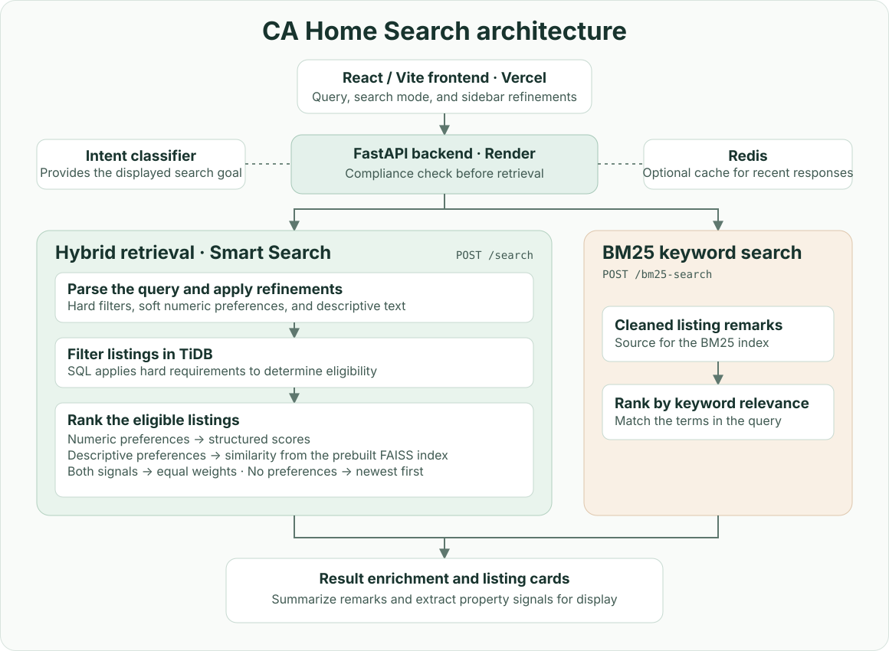

# California Intelligent Home Search System

[Key Features](#key-features) | [Architecture](#architecture-overview) | [What Makes Smart Search Different](#what-makes-smart-search-different) | [Retrieval Benchmark](benchmarks/retrieval/README.md) | [API](#fastapi-endpoints) | [Live Application](#live-application) | [Repo Architecture](#repo-architecture) | [Limitations and Next Steps](#limitations-and-next-steps)

I built this project as part of the **NLP Engineering Internship** track at **IDX Exchange**.

California Intelligent Home Search System is a comprehensive real estate search platform designed to help users discover relevant property listings through both hybrid-retrieval (smart) and BM25 keyword-based search. Here is the link to the web application: [CA Home Search](https://ca-home-search.vercel.app/)

The system combines multiple natural language processing components, including semantic search, BM25 keyword search, query intent identification, query parsing, compliance checks, listing summarization, and property signal extraction. Together, these components help the system better understand user queries, retrieve relevant listings, and present visually intuitive property information in a more structured way.

## Key Features:

- **Query Parsing**  
  Separates hard requirements such as city, budget limits, and room counts from soft numeric targets and descriptive preferences such as a pool or an ocean view.

- **Query Intent Identification**  
  Displays the predicted search goal as browsing, researching, or high-intent inquiry.

- **Hybrid Retrieval (Smart Search)**\
  Filters listings in SQL using hard requirements, then ranks eligible properties by structured preferences, FAISS semantic similarity, or an equal-weight combination of both scores. When there are no ranking preferences, it returns the newest eligible listings first.

- **BM25 Keyword Search**  
  Provides traditional keyword-based retrieval using BM25 ranking, allowing users to search listings based on important terms appearing in property descriptions.

- **Listing Remarks Summarizer**  
  Generates concise summaries from longer listing remarks so users can quickly understand the most important property information.

- **Compliance Checker**  
  Reviews user queries before search to identify potential compliance concerns and helps ensure the search workflow follows appropriate real-estate search guidelines.

- **Listing Signal Extractor**  
  Analyzes listing remarks and extracts important property signals and features, making useful listing characteristics easier to identify at a glance.

## Architecture Overview:



The React/Vite frontend on Vercel sends requests to the FastAPI service on Render. The frontend checks the query for compliance before submitting it for retrieval. A separate intent classifier provides the Search Goal displayed alongside the results.

In **Smart Search**, the parser identifies eligibility constraints, numeric ranking preferences, and descriptive preferences. Sidebar refinements can update the structured criteria while preserving the descriptive preferences from the original query. The backend applies the hard filters to the listings in TiDB, then selects a ranking method based on the available preferences. The semantic path embeds the descriptive text and scores eligible listings against a prebuilt FAISS index. The keyword mode uses a separate BM25 index built from cleaned listing remarks.

Redis can cache recent results when configured. After retrieval, the summarizer and signal extractor process listing remarks, and the frontend displays those details alongside the original listing information.

## What Makes Query-Aware Smart Search Different

The idea of the smart search is from that a single query can contain requirements and preferences that could affect the results in different ways. Moreover, the semantic search pipeline cannot handle queries that contain structural information such as price. Smart Search integrates both semantic information and structural constraints to make effective use of these two heterogeneous data types to serve users a more reliable search system. Smart Search splits the a query into three parts:

| Type of elements in a query | How Smart Search uses it |
|---|---|
| **Hard Constraints** | Apply city, price, and bedroom requirements in SQL to determine which listings qualify. |
| **Soft Structural Constraints** | Give eligible listings closer to the target preferences a higher numeric score. |
| **Semantic Preferences** | Compare the descriptive preference with the saved listing embeddings in FAISS. |

When both preference scores are available, Smart Search combines them with equal weight. When only one type of preferences exist, the system will use the single system's ranking rule to determine the relevance. The same design lets users change structured criteria in the sidebar without rewriting the descriptive part of their query.

## FastAPI endpoints:

| Endpoint | Purpose |
|---|---|
| `GET /health` | Checks whether the Real Estate NLP API is running correctly. |
| `GET /search-options` | Returns listing cities and numeric filter limits for the sidebar. |
| `POST /parse-query` | Separates hard filters, soft numeric preferences, and descriptive search text. |
| `POST /extract-entities` | Extracts entities and property-related information from input text using the entity extractor. |
| `POST /search` | Applies hard filters and ranks eligible listings using the applicable retrieval signals. Results are cached for 5 minutes when Redis is available. |
| `POST /bm25-search` | Returns listings ranked by BM25 keyword relevance. Results are cached for 5 minutes when Redis is available. |
| `POST /summarize` | Generates a concise extractive summary from listing remarks. |
| `POST /check-compliance` | Checks the user query for compliance concerns before the property search is performed. |
| `POST /classify-intent` | Identifies the intent of the property search query and returns the predicted intent with a confidence score. |
| `POST /extract-signals` | Extracts important property signals and features from listing remarks. |

## Live Application

[Open CA Home Search](https://ca-home-search.vercel.app/)

This is the live application of the home search system hosted on Render, Vercel, and TiDB. It supports natural language search through both search pathways, smart search and BM25 keyword search. The switch of these two pathways is beside the search button on the main search page.

After the search, the appliction will direct users to the results page. On the left side bar, it contains two section. The top section allows users to adjust the price range, number of bedrooms, and number of bathrooms, and it will also show the amenities and excluded amenities mentioned in the search query. The bottom section will show the goal of the search query, including browsing, high-intent search, and researching. 

On the right of the results page, users can view retrieved property listings, containing all the necessary information such as address, listing description summary, and property highlights. Users are also able to adjust the number of listings they want to view and sort the listings based on either price or relevance. At the top of the results page, users are also allowed to refine their search through the search bar.


## Repo Architecture:

The `data/` folder contains only placeholders in this repository. The listing datasets and derived artifacts are kept private to protect the underlying listing data.

```text
IDX-nlp/
├── backend/                 # FastAPI backend and Redis integration
│   ├── main.py              # API endpoints for parsing, search, summarization, compliance, etc.
│   └── redis_client.py      # Redis connection used for caching
│
├── data/                    # Data and trained model artifacts
│   ├── models/              # Saved machine learning / NLP models
│   ├── processed/           # Cleaned and processed listing datasets used by search components
│   └── raw/                 # Original/raw datasets
│
├── frontend/                # React + Vite user interface
│   ├── src/                 # Frontend components, styling, and assets
│   ├── index.html           # Frontend entry HTML
│   ├── package.json         # Frontend dependencies and scripts
│   ├── package-lock.json    # Locked dependency versions
│   └── vite.config.js       # Vite development configuration
│
├── scripts/                 # Core NLP and search modules
│
├── taxonomy/                # Property taxonomy and amenity definitions
│   ├── taxonomy_week1.json
│   └── taxonomy_week3_amenities.json
│
├── tests/                   # Unit and integration tests
├── .gitignore               # Files and folders excluded from Git
├── docker-compose.yml       # Multi-service Docker configuration
├── Dockerfile               # Application container configuration
├── README.md                # Project documentation
└── requirements.txt         # Python dependencies
```

## Limitations and Next Steps

### Listing freshness

The application searches a snapshot of California MLS data provided by IDX Exchange. However, new listings, price changes, and status changes such as pending or sold only appear after the dataset is not able to be updated automatically. A property shown in the app may therefore have a different price or may no longer be available. The next step is to integrate an authorized MLS feed, sync listing changes on a schedule, and refresh the search indexes so they reflect those updates.

### Search response time

Broad searches can take longer because the backend has more candidate listings to filter and rank. The interface also waits for listing summaries and extracted property features before displaying the results. The next step is to show listing cards as soon as ranking finishes and add those details as they become available. Measuring database access and ranking separately will help identify where to reduce retrieval time itself.

### Saved preferences and favorite listings

Users can adjust filters during a search, but the app does not remember their preferences across visits or let them bookmark properties. The further improvement is to let users save and edit defaults such as preferred cities, budget, and bedroom count, and keep a shortlist of favorite listings to revisit later. Users should be able to clear their saved preferences and remove listings from their shortlist at any time.

Beyond the limitations mentioned above, I also plan to integrate more functionalities to this application:

### California Market Data Analysis System:

I am also currently preparing to integrate a data analysis and visualization system for real estate agents and house buyers to have an understanding of the current California housing market from a quantitive and intuitive perspective. This could include days on market and closing price trend across all regions and postal code areas in California and also housing price heatmap and seasonality to help users make appropriate purchase decisions

### Multi-agent Housing Assistant:

I also plan to combine the AI agentic project I developed at IDX Exchange to this platform as well by building a built-in multi-agent AI assistant on the application. The detailed functionalities are included in my AI agentic project repo.
