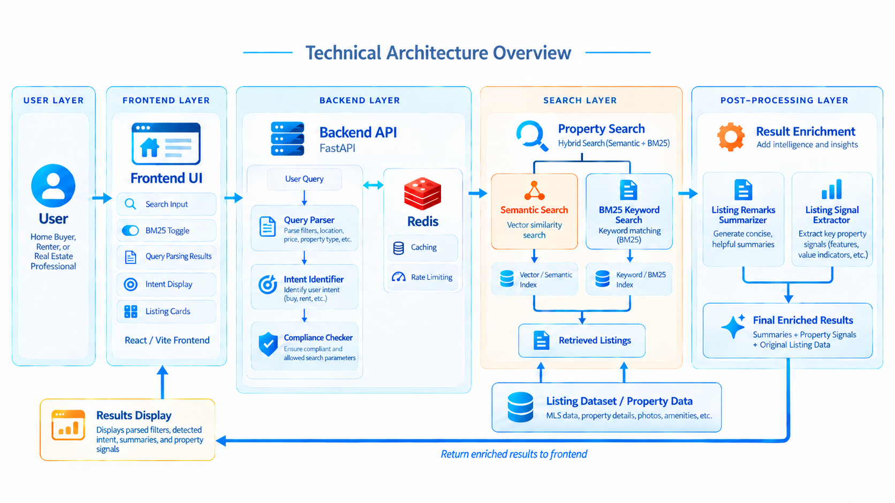

# California Intelligent Home Search System

California Intelligent Home Search System is a comprehensive real estate search platform designed to help users discover relevant property listings through both semantic-based and keyword-based search.

The system combines multiple natural language processing components, including semantic search, BM25 keyword search, query intent identification, query parsing, compliance checks, listing summarization, and property signal extraction. Together, these components help the system better understand user queries, retrieve relevant listings, and present visually intuitive property information in a more structured way.

## Key Features:

- **Query Parsing**  
  Extracts structured search criteria from natural-language queries, including location, price, bedrooms, bathrooms, and amenities.

- **Query Intent Identification**  
  Classifies the purpose of a property search to better understand what the user is trying to accomplish. There are three types of query intent: browsing, researching, and high-intent inquiry

- **Semantic Search**  
  Uses semantic similarity to retrieve listings based on the meaning of the user's query instead of relying only on exact keyword matches.

- **BM25 Keyword Search**  
  Provides traditional keyword-based retrieval using BM25 ranking, allowing users to search listings based on important terms appearing in property descriptions.

- **Listing Remarks Summarizer**  
  Generates concise summaries from longer listing remarks so users can quickly understand the most important property information.

- **Compliance Checker**  
  Reviews user queries before search to identify potential compliance concerns and helps ensure the search workflow follows appropriate real-estate search guidelines.

- **Listing Signal Extractor**  
  Analyzes listing remarks and extracts important property signals and features, making useful listing characteristics easier to identify at a glance.

## Architecture Overview:

<p align="center">
  
</p>

The system follows a modular frontend-backend architecture that separates query understanding, search, and result enrichment. A user submits a natural-language property query through the React/Vite frontend, which sends requests to the FastAPI backend. The backend performs query parsing and intent identification to understand the user's search requirements, while the compliance checker validates the query before property retrieval. The user can choose between semantic search, which retrieves listings based on meaning and similarity, and BM25 keyword search, which ranks listings based on keyword relevance. Redis supports backend caching and rate limiting. After listings are retrieved, the listing remarks summarizer generates concise property descriptions and the listing signal extractor identifies important property characteristics. The enriched results are then returned to the frontend and displayed as structured listing cards.

## FastAPI endpoints:

| Endpoint | Purpose |
|---|---|
| `GET /health` | Checks whether the Real Estate NLP API is running correctly. |
| `POST /parse-query` | Parses a natural-language property query into structured search filters such as location, price, bedrooms, bathrooms, and amenities. |
| `POST /extract-entities` | Extracts entities and property-related information from input text using the entity extractor. |
| `POST /search` | Performs semantic property search and returns the most relevant listings. Results are cached in Redis for 5 minutes. |
| `POST /bm25-search` | Performs BM25 keyword-based property search and returns listings ranked by keyword relevance. Results are cached in Redis for 5 minutes. |
| `POST /summarize` | Generates a concise extractive summary from listing remarks. |
| `POST /check-compliance` | Checks the user query for compliance concerns before the property search is performed. |
| `POST /classify-intent` | Identifies the intent of the property search query and returns the predicted intent with a confidence score. |
| `POST /extract-signals` | Extracts important property signals and features from listing remarks. |

## Repo Architecture:

```text
IDX-nlp/
├── backend/                 # FastAPI backend and Redis integration
│   ├── main.py              # API endpoints for parsing, search, summarization, compliance, etc.
│   └── redis_client.py      # Redis connection used for caching and rate limiting support
│
├── data/                    # Data and trained model artifacts
│   ├── models/              # Saved machine learning / NLP models
│   ├── processed/           # Cleaned and processed listing datasets used by search components
│   └── raw/                 # Original/raw datasets
│
├── frontend/                # React + Vite user interface
│   ├── src/                 # Frontend components, styling, and assets
│   ├── index.html           # Frontend entry HTML
│   ├── package.json         # Frontend dependencies and scripts
│   ├── package-lock.json    # Locked dependency versions
│   └── vite.config.js       # Vite development configuration
│
├── scripts/                 # Core NLP and search modules
│
├── taxonomy/                # Property taxonomy and amenity definitions
│   ├── taxonomy_week1.json
│   └── taxonomy_week3_amenities.json
│
├── tests/                   # Unit and integration tests
├── .gitignore               # Files and folders excluded from Git
├── docker-compose.yml       # Multi-service Docker configuration
├── Dockerfile               # Application container configuration
├── README.md                # Project documentation
└── requirements.txt         # Python dependencies

