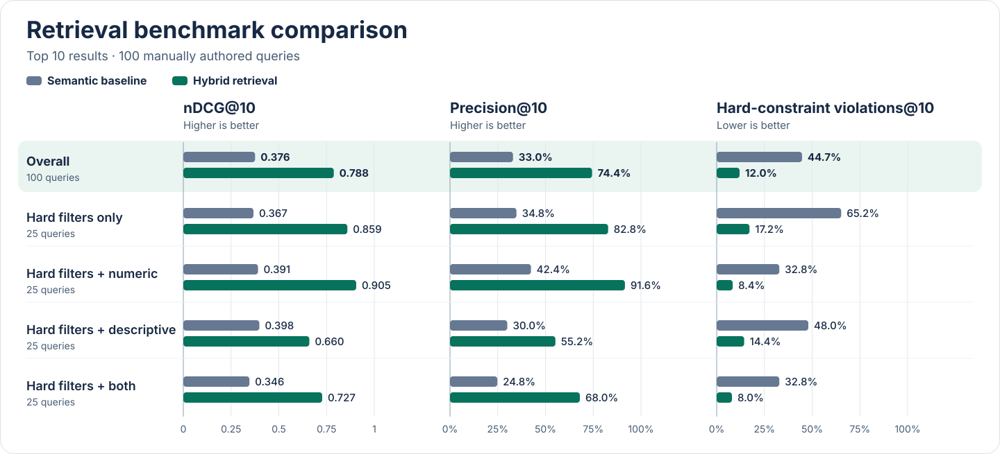

# Retrieval Benchmark

This benchmark contains 100 manually authored queries to test the performance of the newly developed hybrid retrieval pipeline. They are not actual user search logs. 

## Files

- queries.jsonl: machine-readable query set with manually specified intended conditions, numeric preferences, descriptive preferences, and ranking path.
- queries.csv: the same 100 records for reviewing in a spreadsheet; object columns contain JSON.

## Categories

There are in total 4 categories of the queries, and each represents a type that is covered by the retrieval pipeline

- Q001-Q025: hard_only; no numeric ranking rules and no semantic preferences.
- Q026-Q050: hard_structured -> structured ranking; hard conditions and numeric preferences only.
- Q051-Q075: hard_semantic -> semantic ranking; hard conditions and descriptive preferences only.
- Q076-Q100: hard_structured_semantic -> equal-weight combined ranking; all three kinds of intent.

Here, “structured” refers to soft numeric ranking preferences. Every query also has hard eligibility conditions. The annotations distinguish exact requirements, inclusive minimum and maximum bounds, and approximate numeric targets.

## Evaluation process

1. **Define the intended query.** Write the hard filters, soft numeric preferences, descriptive preferences, and expected ranking path for each of the 100 queries independently of the parser. Use `expected_semantic_description` to judge whether the intended meaning is preserved. The annotations specify query intent and supply the criteria for judging each listing.
2. **Freeze the listing corpus.** Use the same 54,838 listings for both systems by taking the intersection of the database snapshot and the saved FAISS index. The run manifest saves the query-set hash, snapshot hash, model configuration, and index fingerprints. Newest-first ranking uses `ListingContractDate`.
3. **Run both retrievers on the original query text.** The semantic baseline embeds the full query with `all-MiniLM-L6-v2` and ranks by similarity across the shared corpus. The hybrid pipeline parses the query, applies the inferred hard filters, and chooses newest-first, structured, semantic, or equal-weight combined ranking based on the parsed preferences. The benchmark records parser route mismatches and uses the actual parser output throughout.
4. **Pool and grade the top results.** For each query, combine the two systems’ top 10, deduplicate by listing ID, and shuffle the pool with system identity, rank, and score hidden. Grade the resulting 1,973 query–listing pairs on a 0–3 relevance scale using listing fields and remarks as evidence. A hard-constraint violation gets grade 0. The saved run uses objective checks where applicable and AI-assisted assessments for other judgments. The grades are provisional and have yet to receive human review.
5. **Measure retrieval at rank 10.** Compute each metric per query, then average across queries. **nDCG@10** rewards placing higher-graded listings earlier and uses the same ideal ranking from the judged pool for both systems. **Precision@10** is the share of the first ten slots filled by results with grades 2 or 3. **Hard-constraint violation rate@10** is the share of returned top-ten results that violate an intended hard filter.

To reproduce the scores from the saved rankings and judgments, run this from the repository root:

```bash
python3 benchmarks/evaluate_retrieval_benchmark.py \
  --input benchmarks/retrieval/runs/comparison_local/top10_with_grades.csv \
  --output /tmp/idx-retrieval-evaluation
```

## Final Results and Comparison



| Query category | Queries | nDCG@10 ↑ Semantic | nDCG@10 ↑ Hybrid | Precision@10 ↑ Semantic | Precision@10 ↑ Hybrid | Violations@10 ↓ Semantic | Violations@10 ↓ Hybrid |
|---|---:|---:|---:|---:|---:|---:|---:|
| **Overall** | **100** | **0.3756** | **0.7878** | **33.0%** | **74.4%** | **44.7%** | **12.0%** |
| Hard filters only | 25 | 0.3672 | 0.8590 | 34.8% | 82.8% | 65.2% | 17.2% |
| Hard filters + numeric preferences | 25 | 0.3911 | 0.9053 | 42.4% | 91.6% | 32.8% | 8.4% |
| Hard filters + descriptive preferences | 25 | 0.3981 | 0.6599 | 30.0% | 55.2% | 48.0% | 14.4% |
| Hard filters + both preference types | 25 | 0.3461 | 0.7271 | 24.8% | 68.0% | 32.8% | 8.0% |

Source data for the chart and table is in [the saved metrics summary](runs/comparison_local/evaluation/metrics_summary.csv).

The hybrid pipeline improved all three top-10 metrics in every query category. Overall, nDCG rose by 0.4122, Precision@10 rose by 41.4 percentage points, and hard-constraint violations fell by 32.7 percentage points. The largest precision gain came from queries with numeric preferences, at 49.2 percentage points. The remaining 12.0% violation rate and 29 mismatches between the intended and actual ranking paths show where parser and filter accuracy still need attention. The comparison reflects a controlled set of manually authored queries and provisional judgments.

